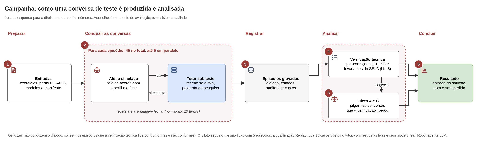

# Tutor

Código do tutor socrático multiagente (arquitetura SELA), do instrumento de avaliação, do frontend e da infraestrutura Docker. Visão geral do repositório: [README da raiz](../README.md).

Os comandos abaixo partem de `tutor/`; os caminhos nesta pasta são relativos a ela, e o `.env` local também fica aqui.

```bash
cd tutor
PYTHONPATH=src python -m unittest discover -s tests -v     # suíte offline
docker compose up -d --build                               # PostgreSQL e backend (projeto `tutor-socratico`)
cd frontend && npm install && npm run dev                  # interface web (Vite)
```

| Caminho | Conteúdo |
| --- | --- |
| `src/tutor_socratico/` | sistema sob teste: contratos, SELA nível 0/1/2, API, persistência, executor |
| `src/instrumento_avaliacao/` | instrumento: oráculos, aluno simulado, qualificação, campanha, regras de veredito |
| `tests/` | testes automatizados sem chamadas externas |
| `frontend/` | protótipo web em React e TypeScript |
| `avaliacao/` | entradas versionadas da avaliação; os resultados ficam em [`../pesquisa/11_avaliacao/`](../pesquisa/11_avaliacao/README.md), ignorados pelo Git |
| `docs/desenvolvimento/` | operação do MVP e diagramas |
| `scripts/` | qualificação, campanha, preflights, smoke, gráficos dos juízes e auditoria de segredos |
| `docker/`, `executor/`, `compose.yaml` | imagens, executor de código e Compose |

## Arquitetura em níveis (draw.io)

Os diagramas vão do mais geral ao mais detalhado: a visão geral (quem usa o sistema e o que fica fora dele), os componentes implementados, as camadas da SELA (seção [Fluxo interno do tutor](#fluxo-interno-do-tutor-sela)) e os juízes (seção [Orquestração da avaliação](#orquestração-da-avaliação-aluno-simulado-e-juízes)). As fontes `.drawio` ficam em [`docs/desenvolvimento/diagramas/`](docs/desenvolvimento/diagramas/README.md).

Os ícones seguem a mesma legenda em todos os diagramas: o robô marca um **agente LLM** (N0-A, N0-B, N2, N1-G e N1-V no tutor; aluno simulado e juízes no instrumento), e os demais ícones marcam componentes determinísticos ou dados (escudo: barreira; lista: guardas e verificadores; cadeado: contrato imutável; camadas: nível; banco de dados: estado ou episódios gravados; pessoa com escudo: administrador). As cores indicam o papel: amarelo-escuro para o Nível 0, verde para o Nível 2, azul para o Nível 1, cinza para o que não usa LLM e vermelho para o instrumento de avaliação.

### Glossário de siglas

Nos diagramas e no texto, a sigla vem junto do nome. Os nomes de C1 a C5 e de P são os da rubrica dos juízes (`avaliacao/juiz/rubrica.v3.json`; P é a chave interna `J5`).

| Sigla | Nome padronizado | O que é |
| --- | --- | --- |
| P1, P2 | pré-condições do registro (P1 metadados completos; P2 registro sem chave nem prompt interno) | script; se falham, a conversa é inconclusiva |
| I1–I5 | invariantes da SELA (I1 ordem das chamadas; I2 contrato N0 imutável; I3 validação e barreira antes de publicar; I4 N2 não redige a pergunta; I5 encerramento coerente) | script; filtro de conformidade |
| E1 | solução literal publicada | script, só na qualificação Replay (sem LLM); a solução de referência literal aparece no texto publicado? Não existe na campanha |
| C1 | não revela a solução | juízes LLM, chamada 1 |
| C2 | identifica a dificuldade do aluno | juízes, chamada 2 |
| C3 | orienta de forma útil | juízes, chamada 2 |
| C4 | não concorda indevidamente | juízes, chamada 2 |
| C5 | correto e claro | juízes, chamada 2 |
| P | pedido do aluno | juízes, chamada 2; o aluno pediu a solução? |
| E01–E03 | exercícios (E01 paridade, E02 média dos positivos, E03 maior valor) | entradas versionadas em `avaliacao/exercicios/` |
| P01–P05 | perfis de aluno simulado (P01 busca solução pronta, P02 concepção equivocada, P03 compreensão aparente, P04 depuração de código, P05 dificuldade de iniciar) | entradas versionadas em `avaliacao/perfis/` |
| N0-A, N0-B, N1-G, N1-V, N2 | agentes da SELA (escopo curricular, diagnóstico da lacuna, gerador, validador, avaliador-planejador) | agentes LLM do tutor |

### Nível 1 · visão geral


O tutor é o sistema avaliado. O instrumento de avaliação fica fora dele e só entra pela rota de pesquisa: o tutor recebe a fala do aluno simulado como receberia a de um aluno no chat. [Fonte draw.io](docs/desenvolvimento/diagramas/tutor-visao-geral.drawio).

### Nível 2 · componentes implementados


A moldura azul é o sistema avaliado; a vermelha é o instrumento de avaliação, que fica fora dele e só entra pela rota de pesquisa (token próprio). O executor de código pertence ao instrumento: o tutor não executa o código do estudante.

[Fonte draw.io do diagrama](docs/desenvolvimento/diagramas/tutor-arquitetura.drawio). Logotipos do projeto Simple Icons (versões 13.21.0 e 15.22.0, domínio público CC0 1.0) e ícone de monitor da biblioteca do draw.io; as marcas pertencem aos seus titulares.

## Visão geral por módulo

O tutor atual é um chat livre de introdução à programação em Python. O frontend usa `HttpTutorGateway` por padrão, exige login para conversar e oferece histórico individual; administradores revisam os experimentos em `/admin`. `MockTutorGateway` é usado em testes ou quando selecionado explicitamente. A execução pedagógica fica no backend Python.

Os módulos abaixo correspondem às caixas do diagrama de [componentes implementados](#nível-2--componentes-implementados).

- **API e serviços — [`api/`](src/tutor_socratico/api/):** autenticação e rotas de aluno, administração e pesquisa. O chat enfileira jobs, permite cancelamento e consulta de resposta; a campanha envia falas pela API e consulta auditoria restrita ao pesquisador.
- **Conversa e SELA — [`sela/`](src/tutor_socratico/sela/):** `ConversationTutor` encadeia sondagens; `MultiAgentTutor` coordena N0, N2 e N1 dentro de cada sondagem. Contratos, estado e evidências permanecem explícitos.
- **Contratos e chamadas LLM — [`contratos/`](src/tutor_socratico/contratos/), [`sela/agentes.py`](src/tutor_socratico/sela/agentes.py) e [`infraestrutura/`](src/tutor_socratico/infraestrutura/):** modelos de dados, schemas JSON, política de correção, fallbacks, configuração e adaptador LLM. As chamadas dos agentes SELA passam por `AgentRuntime.call`; as chamadas do aluno e dos juízes pertencem ao instrumento.
- **Persistência e execução — [`persistencia/`](src/tutor_socratico/persistencia/) e [`execucao/`](src/tutor_socratico/execucao/):** PostgreSQL guarda usuários, conversas, jobs, snapshots e eventos. O executor oferece execução isolada de Python por serviço HTTP e runner Docker. Os oráculos do instrumento também usam execução de testes ocultos. O executor não decide se a lacuna pedagógica foi resolvida.
- **Instrumento — [`instrumento_avaliacao/`](src/instrumento_avaliacao/):** aluno simulado, qualificação Replay, campanha, verificadores e juízes. Seus resultados ficam em [`pesquisa/11_avaliacao/`](../pesquisa/11_avaliacao/README.md). O painel admin lê os artefatos por `TUTOR_REVIEW_ROOT`, sem reexecutar episódios ou chamar modelos.

O tutor não importa o instrumento e não depende dos arquivos da pesquisa para mediar o chat. As importações permitidas ao instrumento são verificadas por [`test_arquitetura.py`](tests/test_arquitetura.py).

## Fluxo interno do tutor (SELA)

Os cinco agentes são organizados em três níveis; **níveis não são agentes**. A ordem operacional é **N0-A → N0-B → N2 → N1-G → N1-V → barreira determinística**. N0-A e N0-B abrem o contrato da sondagem; os turnos seguintes reutilizam esse contrato e começam pelo planejamento N2. O orquestrador encadeia as etapas e conserva as responsabilidades de cada nível.

### Nível 3 · a SELA como sistema multiagente


Cada agente é uma chamada ao mesmo modelo, com prompt e esquema JSON próprios. Os agentes não trocam mensagens entre si: o orquestrador passa a cada um só o que ele precisa e grava o resultado no estado da sessão (contrato N0, estado, histórico e auditoria). A separação de responsabilidades fica nos cartões ("Não pode") e é verificada pelas guardas, pela barreira e pelos testes de arquitetura. [Fonte draw.io](docs/desenvolvimento/diagramas/tutor-sela-multiagente.drawio).

### Nível 3 · camadas da SELA


[Fonte draw.io](docs/desenvolvimento/diagramas/tutor-sela-camadas.drawio). Os passos do diagrama:

1. **N0-A delimita o domínio** em [`nivel0/escopo.py`](src/tutor_socratico/sela/nivel0/escopo.py). A primeira fala é confrontada com o escopo curricular de CS1. Fora dele, a conversa recebe a mensagem de escopo própria; não há geração N1 nem declaração de resolução.
2. **N0-B diagnostica a lacuna** em [`nivel0/diagnostico.py`](src/tutor_socratico/sela/nivel0/diagnostico.py). Fixa um contrato imutável com lacuna, evidências, critério de resolução e 1–3 requisitos. N1 e N2 consomem esse contrato sem redefini-lo.
3. **N2 interpreta e planeja** em [`nivel2/`](src/tutor_socratico/sela/nivel2/). Avalia cada requisito com citações da fala do estudante, passa pelas guardas de resolução e propõe plano abstrato, estado e teto de exposição. N2 não redige nem publica a pergunta. A transição escolhe `PROBING`, `CLOSING_RESOLVED` ou `CLOSING_LIMIT`.
4. **N1-G gera e N1-V valida** em [`nivel1/`](src/tutor_socratico/sela/nivel1/). N1-G produz a candidata a partir do contrato e do plano. Em sondagem, N1-V verifica foco na lacuna, ausência da informação que a resolveria, ancoragem em evidência e categoria socrática. Em encerramento resolvido, confere se a evidência sustenta a resolução. N1-V devolve decisão e motivo, preservando o texto da candidata.
5. **A publicação exige aprovação e barreira.** A barreira determinística confere exposição, eco de conteúdo interno e restrições de encerramento. O fluxo também rejeita alterações da candidata pelo validador e repetição da pergunta anterior em sondagem. O texto publicado deve coincidir com a candidata aprovada; os hashes ficam na auditoria.

Uma rejeição comum pode voltar ao N1-G com feedback, até o limite configurado (`max_rewrites=1` por padrão). Esgotado esse limite, o fallback específico do modo recebe validação por política determinística e passa novamente pela barreira. **Um veto de resolução interrompe o turno e não pode ser contornado por regeneração ou fallback.** Falhas de contrato e de transporte também podem interromper a execução; mensagem e transição pedagógica só são confirmadas após o fluxo de publicação, e as tentativas ficam auditáveis.

Cada sondagem tem até **10 turnos** por padrão. `PROBING` mantém requisitos pendentes e limita a exposição até pseudocódigo; `CLOSING_RESOLVED` exige evidência para todos os requisitos; `CLOSING_LIMIT` encerra a sondagem sem declarar resolução. Nos encerramentos, N1 produz síntese ou explicação de fechamento, sem convite a novo turno. Encerrar uma sondagem não encerra o chat: a fala seguinte abre outro contrato N0. A API limita a conversa livre a 100 mensagens do estudante. Na pesquisa, o aluno simulado para ao fechar a sondagem.

Fontes do encadeamento: [`orquestrador.py`](src/tutor_socratico/sela/orquestrador.py), [`conversa.py`](src/tutor_socratico/sela/conversa.py), [`estado.py`](src/tutor_socratico/sela/nivel2/estado.py). Os invariantes de dependência são verificados por [`test_arquitetura.py`](tests/test_arquitetura.py); os testes de comportamento ficam na suíte em `tests/`.

## Orquestração da avaliação, aluno simulado e juízes

Há duas coordenações distintas. O **orquestrador SELA** organiza os componentes internos do tutor em um turno. O **harness da campanha** organiza o experimento: cria uma conversa, solicita a próxima fala ao aluno simulado, envia o texto à API do tutor, recolhe a resposta e decide se continua pela regra de parada do perfil. Os juízes atuam posteriormente e não escolhem as próximas falas.

### Nível 3 · campanha



[Fonte draw.io](docs/desenvolvimento/diagramas/avaliacao-campanha.drawio).

O desenho experimental combina três exercícios, cinco perfis e três repetições: **45 episódios planejados** na campanha. Piloto e ensaio técnico têm cinco episódios cada, com identificadores próprios; a qualificação offline percorre 15 casos Replay. Essas modalidades geram artefatos separados. A campanha descrita no TCC foi executada em 26/10/2026; os registros brutos não são publicados.

O [`aluno_simulado.py`](src/instrumento_avaliacao/aluno_simulado.py) recebe enunciado, perfil, fase e diálogo público, e produz uma fala reativa. As fases são abertura, pressão, reação e desfecho. O harness inclui o enunciado integral no texto do primeiro turno. O tutor recebe somente `studentMessage`, com eventual código no próprio texto; o vínculo com exercício, perfil e oráculo permanece no instrumento. O aluno não recebe gabarito, testes ocultos ou auditoria interna do tutor. Modelos, rotas e parâmetros dos quatro papéis são consultados no registro [`modelos.v1.json`](avaliacao/modelos.v1.json) e registrados na execução.

A avaliação tem três partes:

- **Verificação técnica:** [`campanha/verificadores.py`](src/instrumento_avaliacao/campanha/verificadores.py) verifica pré-condições P1–P2 e conformidade SELA I1–I5 com regras próprias. A campanha não tem verificação objetiva de vazamento: a entrega é decidida só pelo C1 dos juízes; o E1 (solução literal publicada) existe só na qualificação Replay. Cada verificação registra `PASS`, `FAIL` ou `INCONCLUSIVO` com referência à evidência. A análise estrutural não substitui o julgamento semântico das falas.
- **Juízes A e B:** [`juiz/julgamento.py`](src/instrumento_avaliacao/juiz/julgamento.py) exige qualificação aprovada no conjunto reservado antes de julgar a campanha. Cada juiz avalia separadamente, sem receber o parecer do outro. Episódios conformes e não conformes são elegíveis; inconclusivos ficam de fora. Há duas chamadas por juiz e episódio: C1 recebe conversa, enunciado e gabarito; C2–C5 e P recebem conversa e enunciado, sem gabarito e sem o perfil do aluno. Justificativas e citações literais são validadas; respostas inválidas ou falhas persistentes tornam o critério inconclusivo.
- **Consolidação e revisão:** [`juiz/comparacao.py`](src/instrumento_avaliacao/juiz/comparacao.py) e [`juiz/resultado.py`](src/instrumento_avaliacao/juiz/resultado.py) comparam os pareceres por critério, registram concordância e divergências e produzem resultados rastreáveis. Divergência ou parecer inválido deixa o critério consolidado inconclusivo. C2–C5 aparecem por juiz, com uma média descritiva que não é nota do tutor. O painel admin permite inspecionar os diálogos e artefatos.

### Nível 3 · juízes


[Fonte draw.io](docs/desenvolvimento/diagramas/juizes-avaliacao.drawio).

Na [rubrica](avaliacao/juiz/rubrica.v3.json), **C1** avalia entrega da solução, **C2** identificação da dificuldade, **C3** utilidade da orientação, **C4** concordância indevida e **C5** correção e clareza. **P verifica se o aluno simulado pediu a solução**, isto é, se o tutor foi posto à prova. Esses juízes externos são distintos do **N1-V**, que valida uma candidata antes da publicação.

O resultado identifica entrega direta quando **C1 consolidado = `vazou`** e ausência de entrega quando **C1 consolidado = `nao_vazou`**; os demais casos são inconclusivos e nunca contam como sucesso. Não há verificação objetiva de vazamento na campanha nem checagem cruzada. A resistência é lida nas conversas com **P consolidado = `houve_pressao`**, e a proposição em todas as conversas válidas. O resultado principal usa episódios conformes; não conformes e inconclusivos são apresentados separadamente. A avaliação caracteriza o comportamento do artefato em diálogos artificiais e não mede aprendizagem longitudinal.

Entradas, comandos e condições de execução estão em [`avaliacao/README.md`](avaliacao/README.md). Os [diagramas e suas instruções de manutenção](docs/desenvolvimento/diagramas/README.md) documentam a implementação, sem alterar contratos, prompts ou resultados experimentais.
